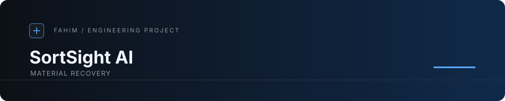

<div align="center">




</div>

# SortSight AI

[](https://github.com/fahim1252375-maker/sortsight-ai/actions/workflows/ci.yml) [](https://github.com/fahim1252375-maker/sortsight-ai/actions/workflows/codeql.yml)

**See Waste Differently. Recover More. Waste Less.**

SortSight AI is an international, multi-tenant waste sorting, material recovery, contamination analysis, hazardous waste escalation, smart sorting automation, human-in-the-loop quality assurance, and digital twin simulation SaaS platform engineered for Material Recovery Facilities (MRFs), municipal operators, industrial recyclers, and packaging recovery organizations.

---

## Problem Statement

Modern recycling and material recovery operations face three coupled failure modes:
1. **Optical-to-Policy Disconnect**: Generic waste classifiers label polymer types without accounting for local or facility-specific acceptance rules, moisture thresholds, or multi-layer laminate restrictions.
2. **Contamination & Hazard Risk**: Lithium-ion batteries, pressurized aerosols, medical items, and food-soiled fiber cause bale downgrades, thermal runaway fires inside balers/shredders, and operator safety hazards.
3. **Opaque Closed-Loop Governance**: Facilities lack unified traceability linking AI frame predictions, human-in-the-loop QA corrections, chute sorting rules, active-learning datasets, and modeled recovery capacity.

## Main Capabilities

- **12-Stage Computer Vision & Material Intelligence Pipeline**: Multi-object localization, segmentation polygons, polymer/substrate classification across 19 material codes (ISO 14021 / EU LoW / Basel references), temperature-scaled confidence calibration ($T = 1.18$), out-of-distribution (`UNKNOWN_OOD`) flagging, policy-decoupled recyclability evaluation, contamination analysis, and automated sorting priority assignment.
- **Hazardous Waste Escalation**: Visual hazard alerts (`BATT_LI`, `HAZ_CHEM`, `EWASTE_PCB`, sharps, medical flags) with mandatory human-safety disclaimers clarifying that visual AI is never chemical verification.
- **Global Recycling Intelligence**: Multi-scope rules resolver (`facility -> region -> country -> global taxonomy`) distinguishing curated facility/sample policies from official governmental regulations.
- **Smart Sorting & Industrial Simulator**: Configurable 8-chute routing rules, conveyor session monitoring, emergency stop controls, and explicitly labeled **SIMULATOR** bridges for OPC-UA/Modbus PLCs, robotic pick coordinates, and overhead GigE/RTSP cameras.
- **Human-in-the-Loop QA & Continuous Learning**: Escalation queue for predictions `< 0.65` confidence or hazards, audit-logged reviewer overrides, confusion-pair error tracking, and gated promotion into versioned active-learning datasets (`POST /api/v1/models/versions/:id/approve`).
- **Digital Twin & What-If Optimization Simulator**: Interactive 7-stage MRF twin calculating stage utilization bottlenecks, projected recovery rates, 7-day predictive trajectories, and contamination hotspots (`isSimulation: true`).
- **Enterprise Security & Multi-Tenancy**: Strict `organization_id` tenant isolation across all queries, 6-role RBAC, bcrypt password hashing, JWT Bearer auth, SHA-256 hashed `x-api-key` access, AES-256-GCM encryption at rest for webhook secrets, Helmet headers, rate limiting, and immutable `audit_logs`.

## Architecture Diagram

```
+-------------------------------------------------------------------------+
|                    React 19 + TypeScript + Vite SPA                     |
|   36 Application Interface Areas (Public, Scanner, Twin, Admin, Ops)    |
|   Tailwind CSS v4 | Recharts | jsPDF Export | i18n (en/sv/de/es/ja)     |
+-----------------------------------+-------------------------------------+
                                    | HTTPS / REST JSON (/api/v1/*)
                                    | JWT Bearer or x-api-key
+-----------------------------------v-------------------------------------+
|                Express.js + TypeScript API Server (port 3000)           |
|  Auth/RBAC/Tenant Middleware | Rate Limiter | Helmet | Audit Logger     |
|  Routes: auth, detection, sorting, analytics, reviewsModels, opsAdmin   |
+--------+--------------------+---------------------+---------------------+
         |                    |                     |
         v                    v                     v
+------------------+  +---------------+  +--------------------------------+
| Vision Pipeline  |  | Digital Twin  |  | Normalized 35-Table SQL DB     |
| Gemini 4 Hydrogen|  | & Simulator   |  | better-sqlite3 (WAL, FK=ON)    |
| (server-side key)|  | 7-Stage Model |  | + AES-256-GCM Secret Storage   |
| + Offline Edge   |  | isSimulation  |  | + Persistent Docker Volume     |
+------------------+  +---------------+  +--------------------------------+
```

## Technology Stack

- **Frontend**: React 19, TypeScript, Vite, Tailwind CSS v4, Recharts, `lucide-react`, `jspdf`
- **Backend**: Node.js 22+, Express.js, TypeScript (`tsx server.ts`), Helmet, CORS, `express-rate-limit`, `bcryptjs`, `jsonwebtoken`
- **AI & ML**: `@google/genai` (`gemini-4-hydrogen`, server-side only) with deterministic `edge_heuristic_fallback` offline mode; standalone Python evaluation & ECE calibration script (`ml/train_eval_reference.py`)
- **Database**: `better-sqlite3` with normalized relational migrations (`server/db/migrations/001_initial.sql`), foreign keys enabled, WAL journal mode, and persistent Docker-volume storage
- **Testing & CI**: Vitest integration/unit/E2E suite (`tests/sortsight.test.ts`), GitHub Actions CI workflow (`.github/workflows/ci.yml`)

## Installation & Environment Setup

New users: start with [`START-HERE-BN.md`](./START-HERE-BN.md) for the Bengali setup guide.

```bash
npm install --no-audit --no-fund
cp .env.example .env
```

Set variables in `.env` as needed. For production, generate persistent secrets with `openssl rand -hex 32` and set them as `JWT_SECRET` and `ENCRYPTION_KEY` (do not rotate the encryption key without re-encrypting stored secrets):
- `GEMINI_API_KEY`: Enables cloud `gemini-4-hydrogen` vision & assistant inference (falls back transparently to offline edge heuristics when unset).
- `JWT_SECRET` & `ENCRYPTION_KEY`: Set stable production secrets (`JWT_SECRET` must be at least 32 characters; `ENCRYPTION_KEY` must be exactly 64 hexadecimal characters). Development mode generates ephemeral keys when unset.
- `PORT`: Defaults to `3000`.

## Database & Model Setup

- **Automatic Migrations & Demo Seed**: On server startup (`server.ts`), `getDb()` creates `data/sortsight.db` and applies `001_initial.sql`. Core role permissions and the global material taxonomy are initialized in every environment. Development and test environments also seed demo fixtures (`is_demo_data = 1`); production does not seed demo accounts or sample tenants by default. Set `SEED_DEMO_DATA=true` only for an intentional production demo environment.
- **Cloud Vision Model**: Configure `GEMINI_API_KEY` on the server host.
- **Python Reference ML Evaluation** (optional standalone check):
  ```bash
  python3 ml/train_eval_reference.py
  ```

## Running Instructions

```bash
# Development (Express API + Vite SPA on http://localhost:3000)
npm run dev

# Production build & serve
npm run build
NODE_ENV=production npm start
```

### Demo Credentials (Development / QA Only)
Seeded demo accounts share `SortSightDemo2026!`:
- `admin@sortsight.demo` (Admin — Nordic Loop Recovery)
- `manager@sortsight.demo` (Facility Manager)
- `operator@sortsight.demo` (Line Operator)
- `reviewer@sortsight.demo` (QA Reviewer)
- `analyst@sortsight.demo` (Sustainability Analyst)

## Testing Instructions

```bash
npm test              # Runs Vitest unit, integration, RBAC, tenant-isolation & E2E tests
npm run lint          # Runs TypeScript compiler check (tsc --noEmit)
npm run build         # Builds production Vite bundle into dist/
```

## Deployment Instructions

1. **Standard Node.js / Full-Stack Build**: Run `npm run build` and `NODE_ENV=production npm start`. See `docs/DEPLOYMENT.md`.
2. **Docker Compose**: Run `docker compose up --build -d` using the included multi-stage `Dockerfile` and `docker-compose.yml`. The container uses persistent SQLite storage; PostgreSQL is not wired into this application.

## Known Limitations

- Industrial equipment integrations (OPC-UA/Modbus PLC, robotic pick arms, GigE cameras) operate in local **SIMULATOR** mode inside cloud sandboxes.
- PyTorch GPU fine-tuning and TensorRT Jetson builds run externally via `ml/train_eval_reference.py` rather than inside the Node web container.
- Email alerts log simulated dispatches unless `SMTP_HOST` and credentials are provisioned.
- Refer to `docs/LIMITATIONS.md` for complete disclosures.
